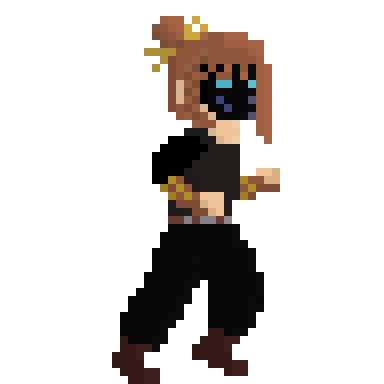
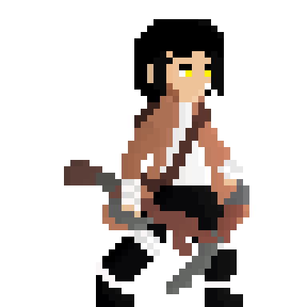
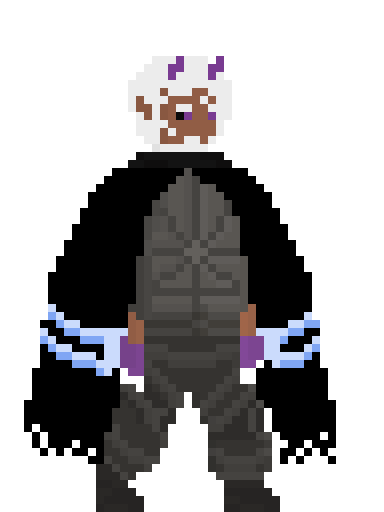

# Portfólio de Pixel Art — TCC

Portfólio de artes em pixel art desenvolvidas para um projeto acadêmico de jogo digital, reunindo cenários, personagens, animações, inimigos e elementos de interface.

## Sobre o projeto

Este repositório apresenta uma seleção das minhas contribuições artísticas para **Reminiscence of Shatters**, um jogo desenvolvido em equipe como parte do Trabalho de Conclusão de Curso (TCC).

O objetivo é apresentar meu trabalho com pixel art, destacando os elementos visuais que produzi para compor o mundo, os personagens e a interface do jogo.

O projeto original pode ser acessado aqui: [Reminiscense of Shatters — repositório do jogo](https://github.com/kauanperesrs/Reminiscense-of-shatters).

## Galeria de artes

### 1. Cenários e ambientes

Artes utilizadas na composição dos ambientes do jogo, incluindo cenários completos e elementos individuais.

- [Ver cenários do jogo](./01_Artes_TCC/01_Cenarios/cenario_do_jogo/)
- [Ver elementos dos cenários](./01_Artes_TCC/01_Cenarios/Elementos%20do%20cenario/)

### 2. Personagens e animações

Personagens apresentados por meio de suas artes e animações, mostrando diferentes movimentos e estados durante o jogo.

**Personagem 01**

[Ver artes e animações do personagem 01](./01_Artes_TCC/02_Personagens/Personagem_01/)

**Personagem 02**

[Ver artes e animações do personagem 02](./01_Artes_TCC/02_Personagens/Personagem_02/)

**Personagem 03**

[Ver artes e animações do personagem 03](./01_Artes_TCC/02_Personagens/Personagem_03/)

[Ver todos os personagens](./01_Artes_TCC/02_Personagens/)

### 3. Inimigos

Artes dos inimigos desenvolvidos para o jogo, incluindo diferentes criaturas e adversários.

- [Golem](./01_Artes_TCC/03_Inimigos/golem/)
- [Javali](./01_Artes_TCC/03_Inimigos/javali/)
- [Lorde](./01_Artes_TCC/03_Inimigos/lorde/)

[Ver todas as artes de inimigos](./01_Artes_TCC/03_Inimigos/)

### 4. Ícones e elementos de interface

Elementos visuais criados para complementar a experiência do jogador e a apresentação das informações durante o jogo.

- [Ver ícones](./01_Artes_TCC/05_Icones/)
- [Ver HUD e elementos de interface](./01_Artes_TCC/06_HUD_Interface/)

### 5. Capturas do jogo

Imagens que ajudam a visualizar as artes aplicadas ao jogo e sua composição dentro da experiência final.

[Ver capturas do jogo](./02_Capturas_Do_Jogo/)

## Créditos do projeto

**Projeto:** Reminiscence of Shatters  
**Tipo:** Trabalho de Conclusão de Curso (TCC) — projeto em equipe  
**Instituição:** ETEC Parque da Juventude — Centro Estadual de Educação Tecnológica Paula Souza  
**Curso:** Ensino Médio com Habilitação Profissional em Programação de Jogos Digitais  
**Ano:** 2024

**Integrantes da equipe:**

- Erick Ueda Cavalcante
- Guilherme Carvalho Venancio
- Gustavo Reis Ramirez Lima
- João Vitor Trindade Silva
- Kauan Da Silva Peres
- Marcelo Alexandre Oliveira Fernandes
- Natan Cardoso De Oliveira

## Autoria e direitos

Este portfólio destaca minhas contribuições artísticas para um projeto coletivo. Ele não representa a autoria individual de todo o jogo.

A utilização e a divulgação dos materiais devem respeitar a autoria de cada recurso, os créditos da equipe e as autorizações aplicáveis ao projeto.
